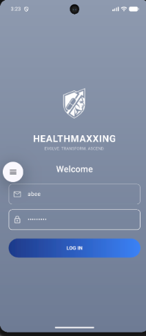
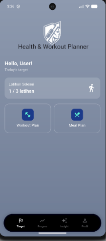
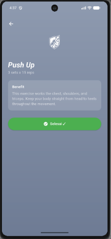
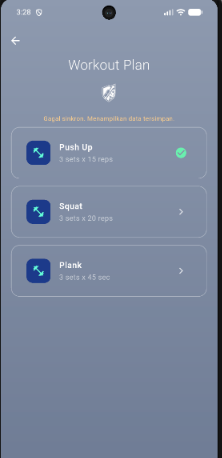
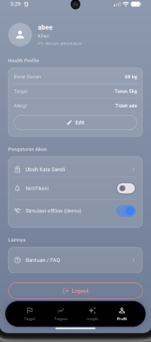
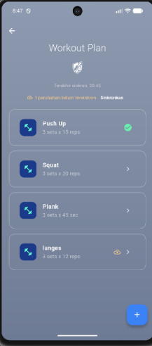
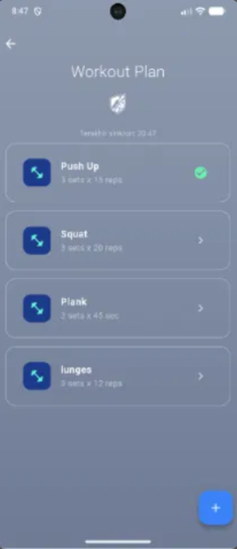
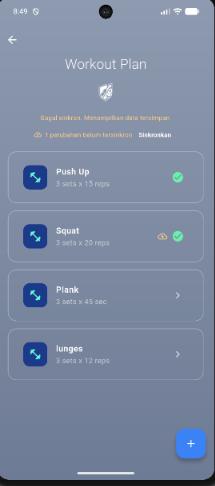

# AC-02 Health & Workout Planner — Mobile App (Flutter)

Bagian mobile app dari capstone AC-02 Personalized Health & Workout Planner, tim A25-CS034 (Kelompok 8).

## Desain Figma

[Healthmaxxing - Health care app](https://www.figma.com/design/kWUcsjUwTxv1BS9xlygtWZ/Healthmaxxing---Health-care-app?node-id=1-131&p=f&t=PybvtPKitXQORiRx-0)

## Cara Setup Project

1. Pastikan Flutter SDK sudah terpasang (`flutter --version`).
2. Clone repository:
   ```
   git clone https://github.com/aberoberoicikiwir-ux/ac02-healthplanner-mobile.git
   cd ac02-healthplanner-mobile/mobile_app
   ```
3. Pasang dependency:
   ```
   flutter pub get
   ```
4. (Jika `app_database.g.dart` belum ada) generate kode Drift:
   ```
   dart run build_runner build
   ```

## Cara Menjalankan Aplikasi

1. Jalankan backend lebih dulu dari folder `backend/` (lihat `backend/README.md`):
   ```
   npm run dev
   ```
2. Nyalakan emulator Android (atau hubungkan device fisik).
3. Dari folder `mobile_app`, jalankan:
   ```
   flutter run
   ```
4. Login memakai akun backend. Untuk demo: `klien_demo` / `demo12345`.
   Akun `pt_demo` ditolak karena aplikasi ini khusus klien.

Alamat backend default:
- Android Emulator: `http://10.0.2.2:3000/api`
- HP fisik: ganti lewat **Profil > Alamat Server** ke `http://<IP-LAN-laptop>:3000/api`

Build debug mengizinkan HTTP polos (`usesCleartextTraffic`) dan sudah meminta izin INTERNET.

## Fitur yang Sudah Diimplementasikan

- Login ke backend asli (JWT disimpan aman), akun non-klien ditolak, sesi otomatis logout saat token kedaluwarsa
- Health Profile: cek otomatis, isi profil lengkap, edit profil, dan pilih PT
- Today's Target: target langkah/air/kalori, catat langkah/air/berat harian
- Workout Plan: rencana dari PT (hari + kategori), tandai selesai (tersinkron ke server), tambah latihan lokal, hapus latihan lokal, tarik-ke-bawah untuk refresh
- Meal Plan: menu per hari, tandai makanan sudah dimakan (tersinkron ke server)
- Progres: grafik berat badan dan langkah harian
- Insight AI: feedback mingguan dari rencana yang disetujui PT + daftar pengingat
- Tanya Coach: chat AI dengan persona PT gym, riwayat per akun, maksimal 20 pertanyaan/hari
- Offline-first: semua data terakhir tetap tampil saat offline; perubahan lokal dikirim saat sinkron
- Bottom Navigation 4 tab: Today's Target, Progres, Insight AI, Profil

## Task 9: Local Storage & Data Persistence

Data dipisahkan ke penyimpanan yang sesuai dengan jenisnya:

| Jenis data | Penyimpanan | Isi di aplikasi ini | File |
|---|---|---|---|
| Data terstruktur | **Drift** (SQLite) | Latihan, menu, target, log harian, cache profil, notifikasi, riwayat chat, status sinkron | `lib/data/local/app_database.dart` |
| Pengaturan (kecil, tidak sensitif) | **shared_preferences** | Switch notifikasi, simulasi offline | `lib/data/local/settings_service.dart` |
| Rahasia | **flutter_secure_storage** | Access token dan username | `lib/data/local/secure_storage_service.dart` |

Token **tidak** disimpan di shared_preferences.

### Penerapan di Drift

- **Offline-first**: UI selalu membaca dari database lokal, bukan langsung dari API. Setiap perubahan ditulis ke database lebih dulu, lalu dikirim ke server saat online.
- **Penanda cache**: kolom `lastFetched` (UTC milliseconds) mencatat kapan data terakhir diambil dari server.
- **Penanda sinkronisasi**: kolom `synced` (`false` = ada perubahan lokal yang belum dikirim) dan `updatedAt` (UTC milliseconds).
- **Stream reaktif**: `watchAllWorkouts()` memakai `.watch()`, sehingga UI otomatis diperbarui saat database berubah.
- **Database transaction**: `upsertServerWorkouts()` dan `markSynced()` membungkus penulisan banyak baris dalam satu `transaction` (atomic).
- **Migrasi schema**: `schemaVersion` naik dari 1 ke 2 (status sinkron), 3 (hari/kategori latihan + menu/target/log/profil), lalu 4 (notifikasi + riwayat Tanya Coach) tanpa menghapus data pengguna.
- **CRUD reaktif**: tambah (tombol +), ubah (Tandai Selesai), hapus (geser ke kiri, hanya latihan buatan sendiri).

### Alur data

```
UI (Consumer) <-- WorkoutProvider <-- .watch() stream <-- Drift (sumber kebenaran)
                                                              ^
              tulis lokal dulu (synced = false)               |
                                                              |
              Sinkronkan: kirim yang belum synced --> ApiService (backend Express)
                          lalu tandai synced = true (transaction)
                          lalu ambil data terbaru dari server (transaction)
```

### Kesesuaian dengan materi Pertemuan 9

| Materi (slide) | Implementasi |
|---|---|
| Memilih penyimpanan menurut jenis data (6) | Drift, shared_preferences, flutter_secure_storage |
| shared_preferences untuk pengaturan (8-9, 12) | Notifikasi dan simulasi offline; token tidak di sini |
| flutter_secure_storage, hapus saat logout (10-11) | Token dan username terenkripsi, dihapus saat logout |
| Schema Drift dengan `synced` dan `updated_at` UTC millis (18) | `workout_entries` |
| Query reaktif `.watch()` (19) | `watchAllWorkouts()` |
| Transaksi atomik dan `markSynced` (21-22) | `upsertServerWorkouts()`, `markSynced()` |
| Migrasi schema (23) | `schemaVersion` 1 ke 4 |
| Offline-first (24-26) | Tulis lokal dulu, sinkron lewat tombol Sinkronkan |
| CRUD reaktif (29) | Tambah, ubah, hapus |

### Global State (Provider)

`WorkoutProvider` membaca dari stream Drift. Menekan "Tandai Selesai" di halaman detail langsung terlihat di layar Workout Plan (centang) dan Today's Target ("X / Y latihan"). `AuthProvider` menyimpan status login, `SettingsProvider` menyimpan pengaturan, `InsightProvider` menyimpan feedback/notifikasi, dan `CoachProvider` menyimpan riwayat chat.

## Struktur Folder

```
lib/
├── data/
│   ├── local/          # Drift, shared_preferences, secure storage
│   ├── remote/         # ApiService (REST ke backend Express)
│   └── repositories/   # Penghubung API dan database
├── models/             # Model data
├── providers/          # State management (Provider)
├── screens/            # Tampilan (UI)
└── main.dart
```

## Integrasi Backend

Mobile sekarang memanggil REST API backend melalui `lib/data/remote/api_service.dart`
(header `Authorization: Bearer <token>`). Mobile dan web tidak pernah mengakses
database atau penyedia AI secara langsung.

- Endpoint yang dipakai: login, profil, pilih PT, workout plan, meal plan, target, log harian, notifikasi, dan Tanya Coach.
- Token JWT disimpan di `flutter_secure_storage`; 401 otomatis mengembalikan pengguna ke layar login.
- Cache lokal dibersihkan saat logout / login akun berbeda, supaya data antar-akun tidak tercampur.
- Tombol "+" (latihan buatan pengguna) tetap lokal karena backend belum punya endpoint-nya.
- Langkah kaki diisi manual di form Today's Target (integrasi pedometer belum ada).
- **Insight AI** menampilkan feedback dari rencana yang disetujui PT dan chat **Tanya Coach**. Gemini tetap dipanggil backend; aplikasi tidak menyimpan API key.
- Tanya Coach tidak menggantikan dokter/PT: pertanyaan medis diarahkan ke profesional, jawaban divalidasi backend, dan dibatasi 20 pertanyaan/hari. PT tidak bisa membaca isi chat.
- Saat offline, riwayat chat tetap tampil tetapi tombol kirim dinonaktifkan (jawaban AI harus real-time). Riwayat bisa dihapus dari tab Tanya Coach.

Untuk mendemonstrasikan mode offline, nyalakan **Simulasi offline (demo)** di tab Profil,
lalu tarik layar Workout Plan / Meal Plan ke bawah. Pesan gagal sinkron muncul, tetapi
data tetap tampil dari database lokal.

## Tampilan Aplikasi (Hasil Slicing)

| Login | Today's Target | Workout Plan |
|---|---|---|
|  |  |  |

| Detail Latihan | Mode Offline | Profil |
|---|---|---|
|  |  |  |

### Sinkronisasi dan CRUD

| Tambah latihan (belum tersinkron) | Setelah Sinkronkan | Offline dengan perubahan tertunda |
|---|---|---|
|  |  |  |
