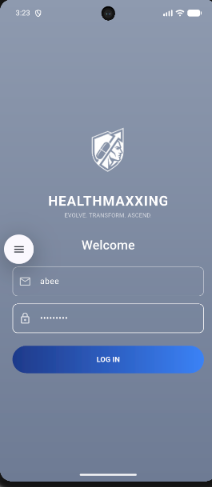
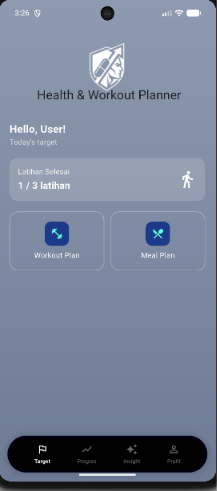
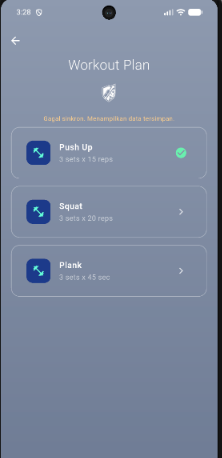
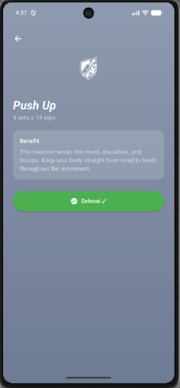
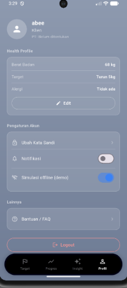

# AC-02 Health & Workout Planner — Mobile App (Flutter)

Bagian mobile app dari capstone AC-02 Personalized Health & Workout Planner, tim A25-CS034 (Kelompok 8).

## Desain Figma

[Healthmaxxing - Health care app](https://www.figma.com/design/hM7Ir66oU2N3Y7ji3qnsT5/Healthmaxxing---Health-care-app?node-id=1-131&p=f&t=H0Xng5JvxTnMfXN9-0)

## Cara Setup Project

1. Pastikan Flutter SDK sudah terpasang (`flutter --version`).
2. Clone repository:
   ```
   git clone https://github.com/aberoberoicikiwir-ux/ac02-healthplanner-mobile.git
   cd ac02-healthplanner-mobile/mobile_app
   ```
3. Pasang dependency:
   ```
   flutter pub get
   ```
4. (Jika `app_database.g.dart` belum ada) generate kode Drift:
   ```
   dart run build_runner build --delete-conflicting-outputs
   ```

## Cara Menjalankan Aplikasi

1. Nyalakan emulator Android (atau hubungkan device fisik).
2. Dari folder `mobile_app`, jalankan:
   ```
   flutter run
   ```
3. Login dengan username dan password apa saja (autentikasi masih tiruan).

## Fitur yang Sudah Diimplementasikan

- Login dengan status login yang tersimpan aman (tidak perlu login ulang saat app dibuka lagi)
- Health Profile check & form input (berat, target, alergi)
- Bottom Navigation 4 tab: Today's Target, Progres, Insight AI, Profil
- Workout Plan dengan sinkronisasi data, status "terakhir sinkron", dan tarik-ke-bawah untuk refresh
- Detail latihan dengan tombol "Tandai Selesai" yang tersimpan permanen
- Meal Plan, Profil (pengaturan akun, logout)

## Task 9: Local Storage & Data Persistence

Data dipisahkan ke penyimpanan yang sesuai dengan jenisnya:

| Jenis data | Penyimpanan | Isi di aplikasi ini | File |
|---|---|---|---|
| Data terstruktur | **Drift** (SQLite) | Daftar latihan dan status selesai | `lib/data/local/app_database.dart` |
| Pengaturan (kecil, tidak sensitif) | **shared_preferences** | Switch notifikasi, simulasi offline | `lib/data/local/settings_service.dart` |
| Rahasia | **flutter_secure_storage** | Access token dan username | `lib/data/local/secure_storage_service.dart` |

Token **tidak** disimpan di shared_preferences.

### Penerapan di Drift

- **Offline-first**: UI selalu membaca dari database lokal, bukan langsung dari API. Data hasil fetch di-cache, sehingga tetap tampil saat offline.
- **Penanda cache**: kolom `lastFetched` (UTC milliseconds) pada tabel `workout_entries`.
- **Stream reaktif**: `watchAllWorkouts()` memakai `.watch()`, sehingga UI otomatis diperbarui saat database berubah.
- **Database transaction**: `upsertWorkouts()` membungkus penulisan banyak baris dalam satu `transaction` (atomic).

### Alur data

```
FakeApiService --(fetch)--> WorkoutRepository --(transaction)--> Drift
                                                                   |
UI (Consumer) <-- WorkoutProvider <------ .watch() stream ---------+
```

### Global State (Provider)

`WorkoutProvider` membaca dari stream Drift. Menekan "Tandai Selesai" di halaman detail langsung terlihat di layar Workout Plan (centang) dan Today's Target ("X / 3 latihan"). `AuthProvider` menyimpan status login dan `SettingsProvider` menyimpan pengaturan.

## Struktur Folder

```
lib/
├── data/
│   ├── local/          # Drift, shared_preferences, secure storage
│   ├── remote/         # Sumber data dari server (saat ini API tiruan)
│   └── repositories/   # Penghubung API dan database
├── models/             # Model data
├── providers/          # State management (Provider)
├── screens/            # Tampilan (UI)
└── main.dart
```

## Catatan tentang Backend

Backend (Express.js + MySQL + AI) dikerjakan terpisah di folder `backend/` dan belum selesai. Untuk sementara, data berasal dari `FakeApiService` yang meniru perilaku API asli (ada jeda jaringan, bisa gagal). Saat backend siap, cukup mengganti isi `lib/data/remote/fake_api_service.dart` dengan pemanggilan HTTP; database, repository, provider, dan tampilan tidak perlu diubah.

Untuk mendemonstrasikan mode offline, nyalakan **Simulasi offline (demo)** di tab Profil, lalu tarik layar Workout Plan ke bawah. Pesan gagal sinkron muncul, tetapi data tetap tampil dari database lokal.

## Tampilan Aplikasi (Hasil Slicing)

| Login | Today's Target | Workout Plan |
|---|---|---|
|  |  |  |

| Detail Latihan | Mode Offline | Profil |
|---|---|---|
|  |  |  |
